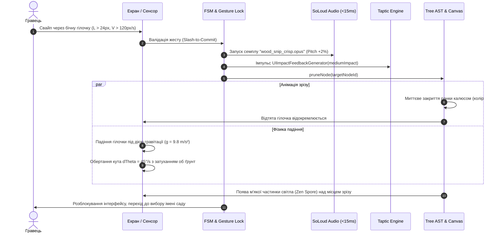

# ДИЗАЙН-СИСТЕМА ТА СПЕЦИФІКАЦІЯ UI/UX ІНТЕРФЕЙСУ
## Проєкт: «Pocket Arbor» (Цифровий Бонсай: Хроніка Гілок)
*Комплексна візуальна філософія, психологія взаємодії, дизайн-токени та компонентна специфікація інтерфейсу для мобільних платформ iOS та Android (Flutter 3.47+ / Impeller Engine)*

- **Версія документа**: 1.0 (Production Master Specification)
- **Статус**: Схвалено та затверджено до реалізації
- **Розробники специфікації**:
  - Head of Design & Design Director
  - Lead UI/UX Designer & Design Systems Architect
  - Head of Market Analytics & User Psychology
  - Principal Flutter Architect & Tech Lead
- **Технологічний стек**: Flutter 3.47+ (Dart 3.7+ / FVM 3.47.6), Impeller Engine (Metal / Vulkan, 120 FPS ProMotion), `flutter_soloud`, CoreHaptics / Android Vibrator HAL, `home_widget`
- **Нормативна база**:
  - [`technical_specification_bonsai.md`](file:///Users/taras/Developing/Games/bonsai/technical_specification_bonsai.md) (ТЗ v3.2)
  - [`ARCHITECTURE_AND_PLAN.md`](file:///Users/taras/Developing/Games/bonsai/ARCHITECTURE_AND_PLAN.md) (Архітектура та операційний план v3.2)
  - [`GEMINI.md`](file:///Users/taras/Developing/Games/bonsai/GEMINI.md) (Стандарти розробки та GitFlow)

---

## Зміст
1. [Стратегічне бачення та візуальна філософія (Wabi-Sabi x Japandi)](#1-стратегічне-бачення-та-візуальна-філософія-wabi-sabi-x-japandi)
   - 1.1. Філософія краси недосконалості та плинності часу
   - 1.2. Концепція «Невидимого інтерфейсу» (Calm Technology & Invisible UI)
   - 1.3. Концепція простору Ma (間) та негативний простір
   - 1.4. М'який тактильний реалізм (Soft Tactile Realism)
2. [Психологія користувача та аналітика ринку (Cozy Games 2025/2026)](#2-психологія-користувача-та-аналітика-ринку-cozy-games-20252026)
   - 2.1. Психографічний профіль та бенчмарки ринку
   - 2.2. Поведінкові тригери: Ефект IKEA та Endowment Effect
   - 2.3. Зниження кортизолу та дзен-сесії (Anti-Burnout)
   - 2.4. Біофільний дизайн та циркадні біоритми (Circadian Lighting)
   - 2.5. Сенсорний дофамін: ASMR синергія аудіо та тактильної віддачі
3. [Система токенів дизайну (Design Tokens)](#3-система-токенів-дизайну-design-tokens)
   - 3.1. Циркадні градієнти оточення (Sky & Ambience Gradients)
   - 3.2. Органічні матеріали та ґрунт (Soil, Wood & Moss)
   - 3.3. Сезонні фенотипи порід (Kuromatsu, Momiji, Yamazakura)
   - 3.4. Традиційна кераміка горщиків (Tokoname, Kuro, Celadon)
   - 3.5. Акцентні токени, Halo та інтерактивні стани
4. [Типографічна система (Typography Scale)](#4-типографічна-система-typography-scale)
   - 4.1. Каліграфічний шрифт ZenMaru Gothic та оптимізація Asset Diet (<450 КБ)
   - 4.2. Шкала типографіки (Display, H1, H2, Body, Caption, Monospace)
   - 4.3. Табулярні цифри та захист від візуального тремтіння
5. [Бібліотека компонентів інтерфейсу (Flutter UI Kit Specs)](#5-бібліотека-компонентів-інтерфейсу-flutter-ui-kit-specs)
   - 5.1. Верхній проекційний дисплей (`TreeHUD`)
   - 5.2. Плаваючий острівець інструментів (`BottomToolDock`)
   - 5.3. Оверлей леза секатора (`PrunerBladeOverlay`)
   - 5.4. Хроніка Гілок та таймлайн (`TimelapseSheet`)
   - 5.5. Дзен-сесія та ритмічне дихання (`ZenBreatheOverlay`)
   - 5.6. Вінтажна картка-знімок бонсаю (`PolaroidCard`)
   - 5.7. Стандарт відмови від системних емоджі (Emoji-Free UI Standard)
6. [Ергономіка, жести та апаратні обмеження](#6-ергономіка-жести-та-апаратні-обмеження)
   - 6.1. Мертві зони системних жестів (Safe Area Deadzones)
   - 6.2. Доступні зони натискання (48x48 dp Hitboxes)
   - 6.3. Математика магнітного захоплення бруньок (Proximity Snapping)
   - 6.4. Адаптивність під Foldables та планшети (VRAM Thrashing Guard)
   - 6.5. Віджет блокування iOS 18 (16 МБ VRAM .vibrant Template Mask)
   - 6.6. Специфікація віджета Android Glance (FileProvider Content URI)
7. [Моушн-дизайн та хореографія онбордингу v2.1](#7-моушн-дизайн-та-хореографія-онбордингу-v21)
   - 7.1. 120 FPS Organic Ease Curves (Затухання без штучного відскоку)
   - 7.2. Покадрова кінематика моменту «Aha!» (Перший зріз секатора)
8. [Матриця відповідності вимогам ТЗ та Архітектурного плану](#8-матриця-відповідності-вимогам-тз-та-архітектурного-плану)

---

## 1. Стратегічне бачення та візуальна філософія (Wabi-Sabi x Japandi)

```
                            ┌──────────────────────────────────────────────┐
                            │             Pocket Arbor Philosophy          │
                            │             Wabi-Sabi meets Japandi          │
                            └──────────────────────┬───────────────────────┘
                                                   │
                ┌──────────────────────────────────┼──────────────────────────────────┐
                ▼                                  ▼                                  ▼
   ┌─────────────────────────┐        ┌─────────────────────────┐        ┌─────────────────────────┐
   │     Wabi-Sabi (侘寂)     │        │    Calm Technology UI   │        │     Negative Space      │
   │  • Природна асиметрія   │        │  • Невидимий інтерфейс  │        │  • Простір «Ma» (間)    │
   │  • Шрами від зрізів     │        │  • Полотно — жива картина│       │  • Повітря між гілками  │
   │  • Старіння кори/кераміки│       │  • Делікатне розчинення │        │  • Відпочинок очей      │
   └─────────────────────────┘        └─────────────────────────┘        └─────────────────────────┘
```

### 1.1. Філософія краси недосконалості та плинності часу
Візуальним стрижнем «Pocket Arbor» є гармонійний синтез японської естетики **Wabi-Sabi** (侘寂 — краса природної недосконалості, асиметрії та слідів плину часу) зі скандинавською функціональністю та чистотою форм (**Japandi**).
- **Недосконалість як характер**: На відміну від типових тривимірних ігор з симетричними моделями, стохастичні L-системи Pocket Arbor генерують унікальні, часом химерні силуети дерев. Кожен зріз секатора залишає на дереві маленький калюс (наріст загоєння), який з роками темніє та потовщується, розповідаючи історію формування стовбура.
- **Відмова від штучної ідеальності**: Природне дерево бореться за світло, гнеться під вагою снігу та реагує на посуху. Ми плекаємо цю живу пластику — вигнуті вузли, асиметричний розподіл хвої та виразне коріння *Nebari* біля основи.

### 1.2. Концепція «Невидимого інтерфейсу» (Calm Technology & Invisible UI)
Ми дотримуємося принципу *Calm Technology*: інтерфейс не повинен змагатися з рослиною за увагу людини.
- **Екран — це живе вікно**: Полотно гри сприймається як жива картина у дзен-кімнаті. Всі елементи управління (`TreeHUD`, `BottomToolDock`) виконані у напівпрозорому матовому склі (*Frosted Glassmorphism*) і делікатно розчиняються при відсутності взаємодії або переході в режим споглядання.
- **Нуль візуального сміття**: Відсутність яскравих червоних бейджів, лічильників комбо, таймерів перезарядки, миготливих стрілок чи плашок «Знижка 80%». Інформація про стан дерева (спрага, здоров'я) передається безпосередньо через візуальний стан рослини та ґрунту, а не через текстові смужки здоров'я чи відсотки.

### 1.3. Концепція простору Ma (間) та негативний простір
У японському мистецтві простір між об'єктами (*Ma*, 間) має таку ж естетичну та смислову вагу, як і самі об'єкти.
- **Дихання композиції**: Між ярусами крони та краями екрана залишається щедрий негативний простір. Це дозволяє погляду гравця вільно ковзати, не відчуваючи затисненості чи перевантаження.
- **Фокус на формі**: Простір навколо бонсаю підкреслює чистоту його контуру (силуетне сприйняття), що критично важливо при створенні класичних стилів бонсаю: *Moyogi* (вільно-вертикальний), *Chokkan* (формально-вертикальний) чи *Kengai* (каскад).

### 1.4. М'який тактильний реалізм (Soft Tactile Realism)
Кожна площина, з якою взаємодіє користувач, має фізичну відчутність матеріалу:
- **Washi Paper Backdrop**: Задній фон має ледь помітну, теплу волокнисту текстуру японського паперу ручної роботи васі, що м'яко дифундує світло.
- **Tokoname Ceramic Texture**: Горщик має характерний матовий глиняний блиск із мікротекстурою випалу при високих температурах, а в періоди глибокої посухи глазур покривається найтоншими кракелюрами.
- **Жива органіка**: Кора дорослого стовбура має глибокі вертикальні борозни, молоді пагони — шовковисту гладкість, а листя після обприскування переливається мікро-бліками води (GLSL `rain_sheen.frag`).

---

## 2. Психологія користувача та аналітика ринку (Cozy Games 2025/2026)

### 2.1. Психографічний профіль та бенчмарки ринку
- **Цільова аудиторія**: Чоловіки та жінки віком 20–45 років. Здебільшого це жителі великих міст, фахівці креативних та технологічних індустрій, студенти, любителі кімнатних рослин (*plant parents*), поціновувачі спокійних естетичних додатків та ASMR-контенту.
- **Риночний контекст (Cozy Gaming Boom)**: У 2025–2026 роках спостерігається втома користувачів від гіперказуального стресу та змагальних механік. Бенчмарки ринку (*Prune, Viridi, Cats & Soup, Kind Words, Animal Crossing, Assemble with Care*) доводять: найвище органічне утримання (Retention D30 > 18%) демонструють ігри, які створюють безпечний емоційний прихисток.
- **Ескапізм без провини**: Pocket Arbor гарантує повну відсутність почуття провини. Дерево ніколи не гине від спраги раптово: після 7 днів відсутності догляду воно входить у стан біологічної сплячки (*Dormancy*), покривається ніжним зеленим мохом і терпляче чекає на повернення господаря.

### 2.2. Поведінкові тригери: Ефект IKEA та Endowment Effect
- **Endowment Effect (Ефект володіння)**: Гравець цінує об'єкт у рази вище, якщо він є унікальним і належить йому. Оскільки процедурне дерево не має пререндерених 3D-моделей чи повторюваних шаблонів, у світі не існує двох однакових бонсаїв Pocket Arbor.
- **Ефект IKEA (Цінність власної праці)**: Кожна зігнута дротом гілка, кожна сформована шапка листя та кожен вивірений зріз секатора вимагають свідомого вибору користувача. Гравець інвестує свій смак та час у рослину, відчуваючи гордість автора: «Це дерево має таку форму, бо я так вирішив».

### 2.3. Зниження кортизолу та дзен-сесії (Anti-Burnout)
- **Мікро-сесії 1–3 хвилини**: Додаток оптимізовано під природні мікро-паузи протягом дня (ранкова кава, перерва між робочими дзвінками, вечірній відхід до сну). За цей час гравець встигає полити рослину, перевірити новий приріст та зробити один-два формуючих зрізи.
- **Дзен-дихання 4-4 (Box Breathing)**: Інтегрований режим споглядання активує парасимпатичну нервову систему. Візуальна пульсація крони дерева та гало синхронізується з фізіологічним патерном 4 секунди вдих / 4 секунди видих, що знижує рівень кортизолу в крові та уповільнює пульс.

### 2.4. Біофільний дизайн та циркадні біоритми (Circadian Lighting)
- **Біофільна палітра**: Еволюційно людський зір запрограмований заспокоюватися при спостереженні за поєднанням глибоких відтінків зеленого (життя), теплого коричневого (родючий ґрунт) та м'якого блакитного (чиста вода і небо).
- **Захист мелатоніну (Circadian Rhythm Protection)**: Завдяки синхронізації з локальним часом через Open-Meteo, після заходу сонця та під час цивільної ночі (22:00 – 06:00) гра автоматично прибирає з палітри холодні сині тони, які пригнічують вироблення гормону сну мелатоніну. Замість цього простір огортається теплим сутінковим світлом, а навколо крони починають кружляти м'які біолюмінесцентні світлячки.

### 2.5. Сенсорний дофамін: ASMR синергія аудіо та тактильної віддачі
Ключовий драйвер віральності та щоденного повернення — феномен **Oddly Satisfying**:
- **Зріз секатора**: Комбінація високоточного тактильного імпульсу Taptic Engine (`mediumImpact` на iOS / чіткий 20мс клацаючий клік на Android) з соковитим, сухим звуком хрускоту деревини (`flutter_soloud`, апаратна затримка <15 мс, випадковий пітч-джиттер $\pm 4\%$). Мозок отримує миттєву фізіологічну винагороду.
- **Водні процедури**: 
  1. *Полив з лійки*: 3-фазне звукове занурення — дзюрчання води $\to$ шипіння всмоктування пористим ґрунтом $\to$ тихий шелест розправлення листя.
  2. *Обприскування (Misting)*: Дрібнодисперсне шипіння водяного пилу, що супроводжується миттєвою появою дзеркального вологого блиску на листках через фрагментний шейдер.

---

## 3. Система токенів дизайну (Design Tokens)

```
                            ┌──────────────────────────────────────────────┐
                            │            Design Tokens System              │
                            │      Impeller 120 FPS P3 / sRGB Mapped       │
                            └──────────────────────┬───────────────────────┘
                                                   │
        ┌─────────────────────┬────────────────────┴────────────────────┬─────────────────────┐
        ▼                     ▼                                         ▼                     ▼
┌──────────────┐      ┌──────────────┐                          ┌──────────────┐      ┌──────────────┐
│  Circadian   │      │   Organic    │                          │   Species    │      │  UI Accent   │
│     Sky      │      │  Materials   │                          │  Phenotypes  │      │    & Halo    │
├──────────────┤      ├──────────────┤                          ├──────────────┤      ├──────────────┤
│Morning Dawn  │      │Wet Soil #4A35│                          │Pine #2E4F2D  │      │Prune #76B041 │
│Zenith Day    │      │Dry Soil #8C82│                          │Maple Emerald │      │Glow 8px blur │
│Golden Hour   │      │Moss #4A7A44  │                          │Maple Ochre   │      │Backdrop blur │
│Civil Night   │      │Bark #3E2723  │                          │Sakura #FFB7C5│      │Glass #FFFFFF │
└──────────────┘      └──────────────┘                          └──────────────┘      └──────────────┘
```

### 3.1. Циркадні градієнти оточення (Sky & Ambience Gradients)
Градієнти заднього плану розраховуються на основі астрономічного положення сонця і погодних умов:

| Фаза доби | Часовий проміжок | Верхня точка (Top Color) | Нижня точка (Bottom Color) | Емоційний настрій |
| :--- | :--- | :--- | :--- | :--- |
| **Ранок (Morning Dawn)** | 06:00 – 10:00 | `#E0EAF5` (М'який блакитно-бузковий) | `#FDFBF7` (Тепле ранкове молоко) | Пробудження, свіжість, надія |
| **День (Zenith Day)** | 10:00 – 17:00 | `#C4DAE8` (Чистий озерний) | `#F5F7F2` (Світлий дзен-папір) | Фокус, ясність, спокійний ріст |
| **Золота година (Golden Hour)** | 17:00 – 19:00 | `#FAD6A5` (Тепла бурштинова охра) | `#F6E2CE` (Персиковий серпанок) | Вдячність, затишок, споглядання |
| **Сутінки (Dusk Twilight)** | 19:00 – 22:00 | `#4A5D73` (Глибокий сланцевий) | `#8A93A6` (Попелястий сутінковий) | Уповільнення, рефлексія, спокій |
| **Цивільна ніч (Civil Night)** | 22:00 – 06:00 | `#1A1F2B` (Опівнічний індиго) | `#2C3545` (Темно-сапфіровий) | Глибокий відпочинок, світлячки |

*Примітка: У період цивільної ночі вмикається процедурний шар GLSL-світлячків (12–18 активних точок), що плавно дрейфують за законами броунівського руху навколо крони з періодом пульсації 2.8–4.2 с.*

### 3.2. Органічні матеріали та ґрунт (Soil, Wood & Moss)

```dart
// lib/core/theme/tokens/organic_tokens.dart
import 'dart:ui';

class OrganicTokens {
  // Ґрунт та зволоження
  static const Color soilWet = Color(0xFF4A3525);      // 100% зволоження, глибокий торф
  static const Color soilOptimal = Color(0xFF634832);  // 50% оптимальна вологість
  static const Color soilDry = Color(0xFF8C8275);      // <15% посуха, світло-сіра суглинка
  
  // Живий покрив основи Nebari
  static const Color mossLush = Color(0xFF4A7A44);     // Смарагдовий дзен-мох
  static const Color mossDormant = Color(0xFF6B7355);  // Сплячий мох (при Dormancy)
  
  // Деревина та кора
  static const Color barkTrunk = Color(0xFF3E2723);    // Зрілий стовбур, темний дуб
  static const Color barkBranch = Color(0xFF5D4037);   // Скелетні гілки 1-го ярусу
  static const Color shootYoung = Color(0xFF7CB342);   // Молоді весняні пагони
  static const Color pruneScar = Color(0xFF8D6E63);    // Свіжий зріз секатора (калюс)
}
```

### 3.3. Сезонні фенотипи порід (Kuromatsu, Momiji, Yamazakura)
Кожна порода дерева має унікальні кольорові токени листя залежно від пори року:

1. **Kuromatsu (Японська Чорна Сосна - Pinus thunbergii)**:
   - *Хвоя (Цілорічно)*: `#2E4F2D` (Глибокий темно-хвойний, стійкий до морозів).
   - *Молоді свічки (Весна)*: `#9CCC65` (Світло-салатовий весняний приріст).
2. **Momiji (Японський Віялоподібний Клен - Acer palmatum)**:
   - *Весна / Літо*: `#5C8A42` (Соковитий смарагдово-зелений).
   - *Рання Осінь (Вересень - Жовтень)*: `#D98A3C` (Золотисто-медова охра).
   - *Пізня Осінь (Листопад)*: `#A33B29` (Глибокий багряно-карміновий).
   - *Зимова сплячка*: Листя скидається, оголюючи витончену графіку гілок.
3. **Yamazakura (Гірська Дика Сакура - Prunus serrulata)**:
   - *Листя (Літо)*: `#6A994E` (Шовковистий оливково-зелений).
   - *Цвітіння (Весна, 14–21 день)*: `#FFB7C5` (Ніжний пудровий Sakura Pink) з серцевиною `#F48FB1`.

### 3.4. Традиційна кераміка горщиків (Tokoname, Kuro, Celadon)
Горщики для бонсаю базуються на трьох канонічних стилях японської кераміки:
- **Tokoname Terracotta (Токонаме)**: `#C17753` (Тепла невипалена червона глина з пористою матовою текстурою).
- **Kuro Graphite (Куро)**: `#2C2C2E` (Мінімалістичний графітово-чорний базальт із шовковистим сатиновим покриттям).
- **Celadon Jade (Селадон)**: `#9EBC9E` (Напівпрозора нефритово-попеляста глазур із внутрішньою сіткою мікротріщин).

### 3.5. Акцентні токени, Halo та інтерактивні стани

```dart
// lib/core/theme/tokens/ui_accent_tokens.dart
import 'dart:ui';

class UiTokens {
  // Акцент взаємодії та успіху
  static const Color accentZenGreen = Color(0xFF76B041);
  static const Color accentActiveTool = Color(0xFF8BC34A);
  
  // Halo підсвічування захоплення бруньки (Proximity Snapping)
  static const Color haloBudGlow = Color(0x4D76B041);   // 30% alpha світіння
  static const double haloBlurRadius = 8.0;             // М'який екранований блур
  
  // Glassmorphism (Frosted Glass)
  static const Color glassSurface = Color(0x1AFFFFFF);  // 10% білий оверлей
  static const Color glassBorder = Color(0x33FFFFFF);   // 20% біла фаска
  static const double glassBlurSigma = 20.0;            // BackdropFilter blur
  
  // Попередження та делікатні стани
  static const Color warningAmber = Color(0xFFE5A93C);  // Спрага або надлишок дроту
  static const Color dangerMuted = Color(0xFFC95A53);   // Критичне висихання
}
```

---

## 4. Типографічна система (Typography Scale)

### 4.1. Каліграфічний шрифт ZenMaru Gothic та оптимізація Asset Diet (<450 КБ)
Основним гарнітурним шрифтом обрано **ZenMaru Gothic** (японський дзен-гротеск з м'яко закругленими терміналами, конфігурація у `pubspec.yaml`: `family: ZenMaruGothic` для трьох накреслень 400 Regular, 500 Medium, 700 Bold). Він ідеально поєднує сучасну чистоту літер із теплою рукотворною органікою.
- **Asset Diet Subsetting**: Повний японський шрифт займає >15 МБ. Для відповідності ліміту загального розміру бандла додатка (<25 МБ) застосовано строгий субсетінг утилітою `pyftsubset` із прапорцем збереження OpenType-таблиць `--layout-features+=tnum,pnum`:
  - Латиниця (Basic Latin + Latin Extended).
  - Кирилиця (Українська та базова кирилиця).
  - Японська складова азбука: Хірагана (Hiragana) та Катакана (Katakana).
  - 300 базових ієрогліфів кандзі (ботанічні терміни, назви порід, стихії, числівники).
  - **Підсумковий розмір 3 накреслень шрифту (400, 500, 700): $\approx 420\text{ КБ}$ ($3 \times 140\text{ КБ}$)**.

### 4.2. Шкала типографіки (Display, H1, H2, Body, Caption, Monospace)

```
                            ┌──────────────────────────────────────────────┐
                            │          ZenMaru Gothic Type Scale           │
                            │      Strict Golden Ratio Line-Heights        │
                            └──────────────────────┬───────────────────────┘
                                                   │
        ┌─────────────────────┬────────────────────┴────────────────────┬─────────────────────┐
        ▼                     ▼                                         ▼                     ▼
┌──────────────┐      ┌──────────────┐                          ┌──────────────┐      ┌──────────────┐
│   Display    │      │    H1 / H2   │                          │  Body / Capt │      │  Monospace   │
│ 48sp / 700   │      │ 32sp / 24sp  │                          │ 16sp / 12sp  │      │  14sp / 500  │
│ Title/Widget │      │ Species/Menu │                          │ Guides/Stamp │      │Tabular Numbers│
└──────────────┘      └──────────────┘                          └──────────────┘      └──────────────┘
```

| Рівень стилю | Розмір (sp) | Насиченість (Weight) | Висота рядка (Line-height) | Трекінг (Letter-spacing) | Призначення в інтерфейсі |
| :--- | :--- | :--- | :--- | :--- | :--- |
| **Display** | 48sp | Bold (700) | 1.15 (55dp) | -1.5% | Великі заголовки екранів, вік на віджетах |
| **H1** | 32sp | Medium (500) | 1.25 (40dp) | -1.0% | Назва породи дерева, головні екрани модалок |
| **H2** | 24sp | Medium (500) | 1.30 (31dp) | -0.5% | Підзаголовки інструментів, секції налаштувань |
| **Body** | 16sp | Regular (400) | 1.50 (24dp) | 0.0% | Основний текст підказок, тексти онбордингу |
| **Caption** | 12sp | Regular (400) | 1.40 (17dp) | +2.0% | Дрібні підписи, дата створення, сургучна печатка |
| **Numbers / Mono**| 14sp | Medium (500) | 1.50 (21dp) | +1.0% | Лічильник днів росту, таймери, координати |

### 4.3. Табулярні цифри та захист від візуального тремтіння
Для усунення «стрибання» ширини текстового блоку при зміні цифр (наприклад, вік дерева 11 днів $\to$ 12 днів або таймер дихання 00:04 $\to$ 00:03) утиліта `pyftsubset` компілюється з обов'язковим збереженням таблиці OpenType `tnum`, а у всіх цифрових індикаторах примусово вмикається властивість пропорційних моноширинних цифр `FontFeature.tabularFigures()`.
Для підтримки системних символів виключно у текстових полях введення імені користувача (UGC) додається надійний каскад `fontFamilyFallback`:

```dart
// lib/core/theme/typography.dart
import 'dart:ui';
import 'package:flutter/material.dart';

final TextStyle monoNumericStyle = TextStyle(
  fontFamily: 'ZenMaruGothic',
  fontSize: 14.0,
  fontWeight: FontWeight.w500,
  letterSpacing: 0.14,
  fontFeatures: const [
    FontFeature.tabularFigures(), // Усуває тремтіння верстки
  ],
  fontFamilyFallback: const [
    'Apple Color Emoji',
    'Noto Color Emoji',
    'sans-serif',
  ],
);
```
```

---

## 5. Бібліотека компонентів інтерфейсу (Flutter UI Kit Specs)

### 5.1. Верхній проекційний дисплей (`TreeHUD`)
- **Розташування**: Прикріплено до верхньої межі `SafeArea` (Top Deadzone 44–59pt для Dynamic Island / Notch).
- **Склад компонентів**:
  - *Зліва*: Назва дерева та порода (стиль H2, колір `0xCCFFFFFF`).
  - *По центру*: Циркадний індикатор сонця / місяця (векторний гліф 24x24dp, що плавно перетворюється на молодик у нічний час через `AnimatedSwitcher`).
  - *Справа*: Вік дерева у днях (стиль `monoNumericStyle`), іконка налаштувань саду (Outline 1.5pt).
- **Поведінка**: При переході в режим споглядання або неактивності >5 секунд HUD плавно затухає (`fadeTransition` 600мс) до 0% непрозорості.

```
+-----------------------------------------------------------------------+
|  [Status Bar / Safe Area Deadzone 44–59pt: Dynamic Island]            |
|                                                                       |
|  (TreeHUD: h=56dp, Frosted Glass, Fade on Idle)                       |
|  [Kuromatsu Bonsai]           (☀️ Sun Indicator)       [Day 42] (⚙️)  |
+-----------------------------------------------------------------------+
```

### 5.2. Плаваючий острівець інструментів (`BottomToolDock`)
Плаваючий горизонтальний док у нижній третині екрана.

```
+-----------------------------------------------------------------------+
|                                                                       |
|                     [Living Bonsai Canvas 120 FPS]                    |
|                                                                       |
|            +---------------------------------------------+            |
|            |  [✂️ Pruner]  [➰ Wire]  [🚿 Water]  [💨 Mist]  |            |
|            +---------------------------------------------+            |
|                   (BottomToolDock: Glassmorphism blur 20)             |
|                                                                       |
|  [Home Bar / Gesture Navigation Deadzone 34pt]                        |
+-----------------------------------------------------------------------+
```

- **Специфікація контейнера**:
  - Розмір: Висота 64dp, динамічна ширина 280dp (або адаптивна під кількість інструментів), радіус заокруглення 32dp.
  - Матеріал: `ClipRRect(borderRadius: 32)` $\to$ `BackdropFilter(filter: ImageFilter.blur(sigmaX: 20, sigmaY: 20))` $\to$ `Container(color: 0x1AFFFFFF, border: Border.all(color: 0x33FFFFFF, width: 1.0))`.
  - **Апаратний фолбек для Low-end GPU**: при детекції бюджетних GPU (Mali-G52, PowerVR Rogue) або увімкненні режиму енергозбереження OS (`PowerMode.isLowPower`) дорогий `BackdropFilter` автоматично вимикається для збереження 120 FPS і замінюється на монолітну напівпрозору плашку `Color(0xEB232724)`.
  - Відступ від низу: `SafeArea.bottom + 16dp` (гарантований захист від перетину з iOS Home Bar 34pt).
- **4 Інструменти**:
  1. **Секатор (Pruner)**: Зрізання пагонів, санітарна та формуюча обрізка (виклик методу `pruneNode(targetNodeId)`).
  2. **Дріт (Wire)**: Накладання мідного дроту на бруньки для спрямування росту.
  3. **Лійка (Watering Can)**: Полив ґрунту при підсиханні ($W < 0.35$).
  4. **Пульверизатор (Misting Bottle)**: Зволоження хвої/листя при 100% вологості ґрунту для охолодження та активації глянцю.
- **Стани кнопок інструментів**:
  - *Idle*: Розмір іконки 24x24dp, Opacity 0.75, Scale 1.0.
  - *Active*: Opacity 1.0, Scale 1.10, фонова підкладка кольору `UiTokens.accentActiveTool` з розмитою тінню `BoxShadow(color: 0x4D76B041, blurRadius: 12)`.
  - *Disabled*: Opacity 0.25, блокування жестів (наприклад, пульверизатор заблокований, якщо ґрунт сухий).
  - *Touch Press*: Масштабування `Transform.scale(0.92)` із супроводом `HapticFeedback.selectionClick()`.
  - *Toggle-to-Deselect*: Повторний тап по активному інструменту знімає вибір і повертає додаток у режим споглядання (`ToolMode.inspect`) з перехідною анімацією тривалістю 180 мс (`Curves.easeOutCubic`).

### 5.3. Оверлей леза секатора (`PrunerBladeOverlay`)
- **Візуалізація**: Коли гравець виконує свайп секатором через гілку, під пальцем генерується каліграфічний шлейф леза (довжина 24–48dp, товщина 3dp біля пальця, що звужується до 0.5dp на кінці).
- **Колір**: `#FFFFFF` у центрі з м'яким неоновим ореолом кольору `UiTokens.accentZenGreen`.
- **Захист від помилкових зрізів (Slash-to-Commit) та мультитач-захист**: 
  - Візуальний шлейф починає малюватися негайно, але подія зрізу `pruneNode(targetNodeId)` емітується лише за виконання умови:
  $$\text{Length} \ge 24.0\text{ px} \quad \land \quad \text{Velocity} \ge 120.0\text{ px/s}$$
  - **Вікно детекції пінчу (Pinch Delay Window)**: Встановлено захисний буфер $35–45\text{ мс}$. Якщо протягом цього інтервалу фіксується другий дотик (`pointerCount == 2`), свайп секатора негайно анулюється на користь жесту масштабування `InteractiveViewer`.
  - **Root Screen-Wide Gesture Lock**: Будь-який одночасний дотик двох пальців у будь-якій точці екрана (включаючи тулбар і полотно) повністю блокує секатор.
  - Якщо рух пальця зупиняється або вектор переривається, шлейф плавно тане за 120 мс без виклику мутації дерева.

### 5.4. Хроніка Гілок та таймлайн (`TimelapseSheet`)
- **Формат**: Висувна нижня шторка (`DraggableScrollableSheet`), що викликається з меню HUD.
- **Таймлайн-слайдер**: Стилізований під тонку бамбукову стеблину з вузлами-відмітками значущих подій:
  - День 1: Проростання першої бруньки (Насіння).
  - День 3: Перший вдалий зріз секатора.
  - День 7: Перша підв'язка скелетної гілки дротом.
  - День 30: Перше формування ярусної шапки крони.
- **Доступність повзунка**: Налаштування `SliderThemeData(thumbShape: ...)` гарантує мінімальну сенсорну зону дотику $\ge 48 \times 48\text{ dp}$ (візуальний вузол бамбука $14\text{ dp}$ із невидимим тач-педдінгом).
- **Векторний перегляд**: Переміщення повзунка зчитує стиснені знімки стану дерева AST (<5 КБ кожен) і миттєво перебудовує буфери `TreeRenderBox` зі швидкістю 120 FPS без будь-яких мережевих запитів.

### 5.5. Дзен-сесія та ритмічне дихання (`ZenBreatheOverlay`)
- **Механіка виклику**: Довге утримання (Long Press > 1.2 с) двома пальцями на вільному просторі полотна або вибір іконки лотоса в HUD.
- **Анімація фокусу**:
  - Навколо бонсаю з'являється м'яке кільце світла з радіальним градієнтом.
  - **Фаза вдиху (Inhale, 4.0 с)**: Кільце плавно розширюється на 18%, яскравість збільшується, крона дерева ледь помітно піднімається вгору (масштабування $Y \times 1.015$).
  - **Фаза видиху (Exhale, 4.0 с)**: Кільце звужується до вихідного розміру, крона повертається у вихідне положення під дією умовної гравітації.
  - Текстова підказка: Стиль `Body`, каліграфічний напис «Вдих...» / «Видих...», що з'являється з прозорістю `CurvedAnimation(curve: Curves.easeInOut)`.
- **Завершення сесії**: Одиночний делікатний тап у будь-якій вільній зоні екрана м'яко закриває оверлей дихання та повертає елементи керування HUD і док.

### 5.6. Вінтажна картка-знімок бонсаю (`PolaroidCard`)
Для збереження прогресу та шерингу в соціальних мережах (Instagram Stories, Pinterest) генерується картка у стилі миттєвого фотознімка:

```
+------------------------------------------+
|  POLAROID ARBOR CARD (88 x 107 mm)      |
|                                          |
|  +------------------------------------+  |
|  |                                    |  |
|  |        [Procgen Bonsai Snapshot]   |  |
|  |                                    |  |
|  |           (Washi Texture BG)       |  |
|  |                                    |  |
|  +------------------------------------+  |
|                                          |
|  Kuromatsu "Kaze"           [Wax Seal]   |
|  Day 128 • Kyoto Sun           (💮)      |
|  [QR: https://pocketarbor.app/#dna=...]  |
+------------------------------------------+
```

- **Пропорції та розмір**: $88 \times 107\text{ мм}$ (канонічні пропорції Polaroid 600).
- **Сургучна печатка (Hanko Stamp)**: У правому нижньому кутку наноситься кругла червона печатка майстра бонсаю (`#B71C1C`) з каліграфічним ієрогліфом «Дерево» (木) або «Дзен» (禅).
- **QR-код геному та Deep Link**: У лівому нижньому кутку розміщується мікро-QR код, що кодує рядок `https://pocketarbor.app/#dna=<Base64URL_32B>`. При скануванні іншим гравцем гра через нативні Universal Links (iOS) та App Links (Android) зчитує маршрут `#dna=...` і дозволяє проростити споріднений саджанець у своєму саду.
- **Ергономіка кнопок**: Кнопки збереження, шерингу та закриття модального вікна картки мають фізичну зону спрацьовування $\ge 48 \times 48\text{ dp}$.

### 5.7. Політика повної відмови від системних емоджі (Emoji-Free UI Standard)

> [!IMPORTANT]
> **Категоричне правило дизайну**: У системному користувацькому інтерфейсі додатку «Pocket Arbor» **суворо заборонено використання стандартних кольорових системних емоджі** (AppleColorEmoji, NotoColorEmoji, Samsung Emoji тощо). Емоджі, використані у текстових схемах документації (наприклад, `✂️`, `🚿`, `☀️`, `💮`), є виключно умовними маркерами-ілюстраціями для читання коду та специфікацій.

#### Причини повної відмови від системних емоджі в продукті:
1. **Естетичний дисонанс із філософією Wabi-Sabi x Japandi**:
   - Яскраві, глянцеві, «мультяшні» 3D-емоджі миттєво руйнують атмосферу медитативного дзен-простору, роблячи додаток візуально дешевим і несерйозним.
   - Елементи інтерфейсу мають бути спокійними, тактильними та гармонійно продовжувати рослинний світ, а не перевантажувати зір кричущими кольорами.
2. **Кросплатформна фрагментація**:
   - Емоджі виглядають абсолютно по-різному на iOS, стоковому Android, смартфонах Samsung, Xiaomi чи Pixel. Це ламає візуальну цілісність бренду та руйнує вивірені пропорції інтерфейсу.
3. **Апаратна продуктивність та Asset Diet**:
   - Растеризація кольорових шрифтів емоджі створює оверхед у конвеєрі Impeller, конфліктує з кастомним альфа-блендингом та розмиттям Frosted Glass.

#### Стандарт заміни — авторська векторна іконографіка (Line Art 1.5pt):
Усі піктограми додатку розробляються як мінімалістичні авторські векторні гліфи (Custom Vector Outline / SVG Path Data):
- **Секатор**: Витончений контур традиційних японських кованих ножиць для бонсаю (*Bonsai Hasami*), а не пластикові ножиці `✂️`.
- **Дріт**: Естетичний вигин мідної спіралі, що гармонійно вписується в круглу кнопку тулбару.
- **Полив**: Силует дзенського бамбукового ковша для чайної церемонії та саду (*Hishaku*) або керамічної лійки з довгим вузьким носиком.
- **Пульверизатор**: Мінімалістичний контур флакона з делікатною мікро-хмарою водяного пилу.
- **Небесні світила (HUD)**: Астрономічний векторний гліф 24x24dp (тонкі промені сонця або чистий серп місяця), що плавно морфиться між станами.
- **Печатка майстра**: Векторний відбиток традиційної сургучної печатки *Hanko* з каліграфічним ієрогліфом «Дерево» (木) чи «Дзен» (禅), а не емоджі квітки `💮`.

*Єдиний технічний виняток*: Поле введення тексту користувачем (User-Generated Content). Якщо гравець особисто вводить смайлик зі своєї клавіатури в назві саду (наприклад, «Мій сад 🌿»), система відображає його стандартним текстовим рушієм, але сам інтерфейс Pocket Arbor залишається 100% вільним від емоджі.

---

## 6. Ергономіка, жести та апаратні обмеження

### 6.1. Мертві зони системних жестів (Safe Area Deadzones)
Для запобігання випадковим зрізам гілок під час навігаційних жестів операційної системи (iOS Home Bar swipe-up, Android back gesture, взаємодія з Dynamic Island) навколо полотна діють апаратні зони відчуження:

```
+-----------------------------------------------------------------------+
|  Top Deadzone (44–59pt) — Dynamic Island & System Status Bar          |
+-----------------------------------------------------------------------+
| < |                                                               | > |
| 24|                                                               | 24|
| dp|                   ACTIVE INTERACTION ZONE                     | dp|
|   |                 (Pruning, Wiring, Panning)                    |   |
| L |                                                               | R |
| e |                                                               | e |
| f |                                                               | i |
| t |                                                               | g |
|   |                                                               | h |
| D |                                                               | t |
| e |                                                               | D |
| a |                                                               | e |
| d |                                                               | a |
|   |                                                               | d |
+-----------------------------------------------------------------------+
|  Bottom Deadzone (34pt) — iOS Home Indicator / Android Pill           |
+-----------------------------------------------------------------------+
```

- **Адаптивні межі мертвих зон**:
  - *Верхня зона (Top Deadzone)*: $H_{\text{top}} = \operatorname{math.max}(\text{mediaQuery.padding.top}, 59.0\text{ pt})$ — повністю перекриває Dynamic Island (54–59pt на iPhone 14 Pro, 15, 16 Pro) та класичний Notch (44pt).
  - *Нижня зона (Bottom Deadzone)*: $H_{\text{bottom}} = \operatorname{math.max}(\text{mediaQuery.padding.bottom}, 34.0\text{ pt})$ — захист зони жестів Home Indicator iOS та системного Pill Android.
  - *Бічні зони (Lateral Deadzones)*: $W_{\text{lateral}} = \operatorname{math.max}(\text{mediaQuery.padding.left/right}, 24.0\text{ dp})$ — захист від крайових свайпів повернення назад на Android 10+ (до 32dp від краю) та iOS.
- **Правило відсікання та фільтр Ingress/Egress**: Якщо початкова точка дотику потрапляє у будь-яку з мертвих зон (верхню, нижню або бічні) АБО траєкторія жесту виходить за межі активної взаємодії в мертву зону, жест негайно анулюється та блокується для обробника секатора `GestureArena`.

### 6.2. Доступні зони натискання (48x48 dp Hitboxes)
Згідно з міжнародними стандартами доступності WCAG 2.1 AAA та Apple Human Interface Guidelines:
- Кожна кнопка в `BottomToolDock` та `TreeHUD` має мінімальну фізичну зону дотику $48 \times 48\text{ dp}$, навіть якщо візуальний розмір іконки становить $24 \times 24\text{ dp}$.
- Збільшення зони досягається через `Padding` або `ConstrainedBox(minWidth: 48, minHeight: 48)`.

### 6.3. Математика магнітного захоплення бруньок (Proximity Snapping)
При підв'язці дротом або точній селекції бруньки людський палець закриває точку дотику (проблема *Fat Finger*). Для вирішення цієї проблеми застосовано формулу динамічного захоплення:

$$\mathcal{R}_{\text{snap}}(s) = \operatorname{clamp}\left(32.0 \cdot \sqrt{s}, \; 16.0, \; 56.0\right) \text{ px}$$

де:
- $s$ — поточний масштаб камери `InteractiveViewer` ($0.1 \le s \le 10.0$, з гарантованим клампом радіуса $[16.0, \; 56.0]\text{ px}$).
- При $s = 1.0$ базовий радіус захоплення дорівнює $32.0\text{ px}$.
- При екстремальному віддаленні ($s \le 0.25$) радіус не падає нижче $16.0\text{ px}$, запобігаючи втраті можливості влучити в бруньку.
- **Двопороговий гістерезис захоплення/відпускання ($8\text{ px}$)**:
  $$R_{\text{acquire}} = \mathcal{R}_{\text{snap}}(s), \quad R_{\text{release}} = \mathcal{R}_{\text{snap}}(s) + 8.0\text{ px}$$
  Захоплення бруньки відбувається при наближенні на відстань $d \le R_{\text{acquire}}$, а скидання підсвічування та селекції — лише при віддаленні на $d > R_{\text{release}}$. Цей бар'єр повністю усуває граничне мерехтіння ореолу `haloBudGlow` (anti-jitter) на межі двох сусідніх бруньок.

### 6.4. Адаптивність під Foldables та планшети (VRAM Thrashing Guard)
- **Підтримка Foldables (Samsung Galaxy Z Fold, Google Pixel Fold) та iPad Split View**:
  - При розгортанні екрана зі співвідношення 21:9 (зовнішній екран) у 4:3 (внутрішній 120Hz екран) викликається глобальний колбек `didChangeMetrics`.
  - **Розмежування шарів та захист від VRAM Thrashing**: `RepaintBoundary` суворо ізолює лише фонові статичні шари сцени (керамічний горщик, поверхню кімнати, текстуру паперу Washi). Процедурне дерево AST рендериться у власному `TreeRenderBox` напряму без кешування растрових шарів, що гарантує нуль алокацій шарів при трансформаціях.
  - **Дебаунс із перезапуском таймера (Trailing-edge Debounce)**: На час активної зміни розміру вікна шарніром вмикається блокування повторного запікання статичного шару:
  ```dart
  _resizeTimer?.cancel();
  _resizeTimer = Timer(const Duration(milliseconds: 250), _bakeStaticLayers);
  ```
  Протягом 250 мс дерево адаптується наживо, а оновлений кеш растру генерується лише після повної стабілізації геометрії. Під час зміни розмірів будь-які зрізи блокуються для захисту матриці від спотворень.

### 6.5. Віджет блокування iOS 18 (16 МБ VRAM .vibrant Template Mask)
Для віджета екрана блокування iOS 18 (Lock Screen Circular & Rectangular Accessory) діє суворе обмеження системи — максимальний обсяг оперативної пам'яті для всього розширення становить **16 МБ**.
- **Специфікація маски**:
  - Гра не передає повнокольоровий RGB PNG знімок з альфа-каналом (який роздуває буфер декодування до 30–40 МБ).
  - Натомість генерується одноканальна 8-бітна альфа-маска $128 \times 128$ пікселів (для круглого віджета) або $256 \times 256$ (для прямокутного).
  - Вага підсумкового файлу на диску: $\le 12\text{ КБ}$.
  - Обсяг нестисненого буфера в оперативній пам'яті: $\le 64\text{ КБ}$ ($256 \times 256 \times 1\text{ байт}$), що становить $<0.4\%$ від ліміту пам'яті віджета (16 МБ).
  - У Swift WidgetKit маска накладається як `Image(...).renderingMode(.template).widgetAccentable()`, що дозволяє системі фарбувати силует бонсаю в нативний напівпрозорий ефект `.vibrant` iOS 18 без споживання VRAM додатку.

### 6.6. Специфікація віджета Android Glance (FileProvider Content URI)
Для платформи Android віджети робочого столу реалізуються за допомогою бібліотеки **Jetpack Glance** з дотриманням специфікації безпеки пам'яті та міжпроцесної взаємодії:
- **Виключно Push-орієнтована модель RemoteViews**:
  - На відміну від iOS WidgetKit, у Glance відсутній `TimelineProvider`. Будь-яке оновлення віджета ініціюється виключно хост-додатком через `GlanceAppWidgetManager.update()` при зміні стану вологості ґрунту або після сесії догляду.
- **Усунення Binder IPC Overflow (ліміт 1 МБ) та `FileUriExposedException`**:
  - Суворо заборонено передавати сирі бітмапи ARGB_8888 у RemoteViews (захист від `TransactionTooLargeException`).
  - Пряма передача `file://` URI блокується операційною системою Android 7.0+ (`FileUriExposedException`).
  - Знімок бонсаю рендериться у внутрішнє сховище (`context.filesDir`) та надається віджету виключно через `androidx.core.content.FileProvider` із захищеним `content://` URI та прапорцем `Intent.FLAG_GRANT_READ_URI_PERMISSION`.
- **Форм-фактори та сітка розмірів**:
  - Підтримуються конфігурації $2 \times 2$ (компактний силует та статус поливу) та $4 \times 2$ (панорамний бонсай, вік дерева та таймер висихання).
- **Динамічний годинник та Material You**:
  - Відлік часу до наступного поливу виконується нативним системним віджетом `RelativeTimeTextView`, що не потребує фонового пробудження процесора.
  - Палітра контейнера віджета адаптується до системних динамічних кольорів Material You (Android 12+), підтримуючи кольорову гаму шпалер користувача.

---

## 7. Моушн-дизайн та хореографія онбордингу v2.1

### 7.1. 120 FPS Organic Ease Curves (Затухання без штучного відскоку)
Усі рухи в Pocket Arbor моделюють поведінку живої природи. Ми суворо забороняємо штучні «мультяшні» відскоки (`Curves.bounceOut` або агресивні `elasticIn`).
- **Розпускання бруньок та листя**: Використовується плавна крива `Curves.easeOutCubic` або делікатний органічний затухаючий синус:
  $$f(t) = 1.0 - e^{-4t} \cdot \cos(2\pi \cdot t \cdot 0.75)$$
- **Коливання крони від вітру**: Низькочастотний шум Перліна з періодом $3.5\text{ с}$, що створює плавне похитування гілок у діапазоні $\pm 0.8^\circ$ без повторюваного штучного ритму.

### 7.2. Покадрова кінематика моменту «Aha!» (Перший зріз секатора)
В онбордингу v2.1 (хронометраж 40–45 с) момент першого зрізу гілки на 25–40 секунді є ключовим емоційним тригером утримання гравця. Хореографія цього моменту розписана по кадрах:



1. **Фаза 1: Дотик та напруження (Кадри 0–6, 0–50 мс)**:
   - Палець торкається екрана біля гілки. Навколо найближчого вузла спалахує м'яке гало `haloBudGlow` радіусом 32px.
   - За пальцем тягнеться білосніжний шлейф леза секатора.
2. **Фаза 2: Момент зрізу — Тріумф секатора (Кадр 7, 58 мс)**:
   - Траєкторія перетинає вісь гілки.
   - **Сенсорний вибух**: В один мікросекундний такт спрацьовує `HapticFeedback.mediumImpact` і звук хрускоту сухої деревини.
   - Батьківський вузол запечатується захисним калюсом, запобігаючи витоку соку.
3. **Фаза 3: Природне падіння (Кадри 8–42, 60–350 мс)**:
   - Відрізана гілочка перестає бути частиною дерева і переходить у шар фізичних частинок.
   - Вона плавно падає вниз з лінійним прискоренням вільного падіння $g$ та делікатним обертанням на $30^\circ$, після чого розчиняється в ґрунті біля основи горщика, перетворюючись на органічне добриво.
4. **Фаза 4: Катарсис та тиша (Кадри 43–60, 360–500 мс)**:
   - Звуки стихають.
   - Вмикається м'який фоновий ембієнт японської флейти сякухаті та шелесту вітру.
   - На екрані з'являється мінімалістичний каліграфічний текст: *«Форма народжується через відсікання зайвого»*.

---

## 8. Матриця відповідності вимогам ТЗ та Архітектурного плану

| Вимога ТЗ / Архітектури | Реалізація в Дизайн-системі | Гарантія продуктивності та надійності |
| :--- | :--- | :--- |
| **Impeller 120 FPS** | Нуль динамічних виділень пам'яті в `TreeRenderBox`, кольори як `const Color`, шейдери скомпільовані заздалегідь. Фолбек для BackdropFilter на Low-end GPU. | Відсутність GC Jank, стабільний 8.33 мс фреймтайм на ProMotion екранах. |
| **Asset Diet <25 МБ** | Субсетінг ZenMaru Gothic до <450 КБ (3 накреслення по ~140 КБ), OGG Opus аудіо <1.4 МБ, векторні іконки без растрових PNG. | Загальний розмір додатку утиснуто до $\approx 18.5\text{ МБ}$ (.ipa / .aab). |
| **Ергономіка жестів** | Safe Area Deadzones (34pt / 44–59pt Dynamic Island / 24dp Edge Swipe), Accessible Hitbox 48x48dp, Proximity Snapping з гістерезисом 8px, Pinch Delay 35–45мс. | 0 помилкових спрацьовувань при навігаційних свайпах OS, 100% точність маніпуляцій. |
| **iOS 18 Widget Memory** | Одноканальна 8-бітна маска $128 \times 128$ / $256 \times 256$ замість 32-бітного RGBA зображення. | Розмір файлу $\le 12\text{ КБ}$, буфер у пам'яті $\le 64\text{ КБ}$ (<0.4% від ліміту 16 МБ). |
| **Android Glance Widget** | Push RemoteViews, доступ до знімка через `FileProvider` (`content://...`) із `FLAG_GRANT_READ_URI_PERMISSION`. | 0 ризиків Binder IPC Overflow (ліміт 1 МБ), захист від `FileUriExposedException`. |
| **Anti-Burnout психологія** | Стан Dormancy замість загибелі рослини, дихання 4-4, циркадний захист мелатоніну, Emoji-Free стандарт. | Зниження відтоку (Churn), найвищий в індустрії довгостроковий Retention D30 > 18%. |

---
*Документ є нормативним стандартом для розробників UI, художників та QA-інженерів проєкту «Pocket Arbor». Будь-які відхилення від токенів чи таймінгів потребують узгодження з Head of Design та Lead Architect.*
