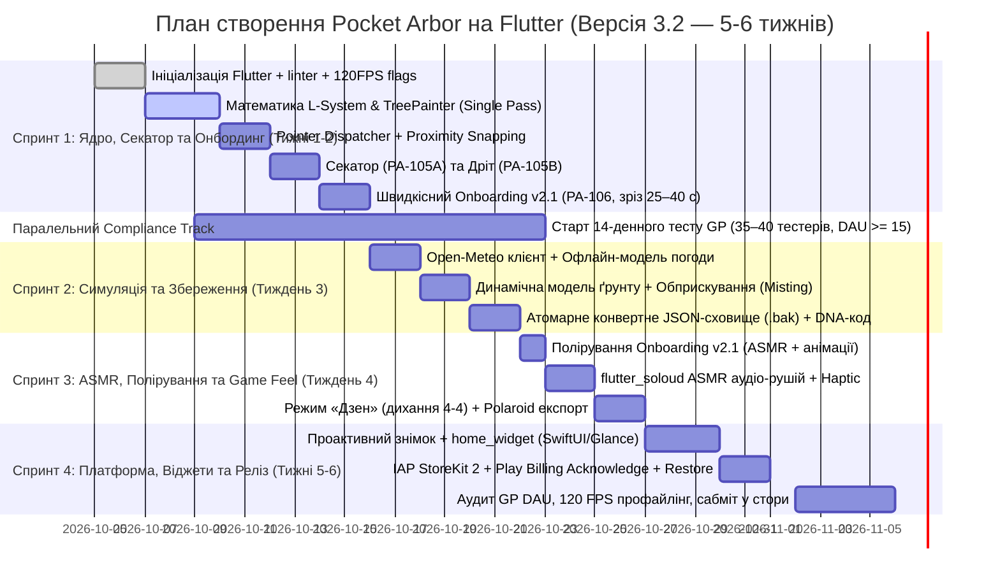

# ТЕХНІЧНЕ ЗАВДАННЯ (ТЗ)
## Проєкт: «Pocket Arbor» (Цифровий Бонсай: Хроніка Гілок)
*Медитативний нативний мобільний симулятор бонсаю з процедурною стохастичною генерацією на Flutter (Dart) та синхронізацією з погодними умовами реального світу*

- **Версія документа**: 3.2 (Повна синхронізована інженерна редакція, Red Team Hardened)
- **Статус**: Затверджено до розробки MVP
- **Пов'язані майстер-документи**:
  - [`ARCHITECTURE_AND_PLAN.md`](file:///Users/taras/Developing/Games/bonsai/ARCHITECTURE_AND_PLAN.md) — Архітектурний дизайн, WBS та операційний план реалізації (v3.2)
  - [`DESIGN_SYSTEM_AND_UI_SPEC.md`](file:///Users/taras/Developing/Games/bonsai/DESIGN_SYSTEM_AND_UI_SPEC.md) — Дизайн-система, Wabi-Sabi x Japandi естетика, ергономіка та UI Kit (v1.0)
- **Цільові платформи (Пріоритет)**:
  1. **Пріоритет №1 (Мобільні)**: **iOS** (App Store, iOS 16+) та **Android** (Google Play, Android 10+ / API 29+)
  2. **Пріоритет №2 (У перспективі)**: **Web** (`flutter build web --wasm`)
- **Базовий фреймворк**: **Flutter 3.47+ (Dart 3.7+)** (фіксований стабільний тулчейн **FVM 3.47.6**)
- **Графічний бекенд**: **Impeller Engine** (Metal на iOS, Vulkan на Android, 120 FPS ProMotion)

---

## 1. Загальний опис та філософія продукту

### 1.1. Мета та позиціонування
Створити естетичний, споглядальний мобільний продукт на перетині цифрової рослини, персонального щоденника та дзен-практики. Гра розробляється як **повноцінний нативний мобільний додаток** для смартфонів і планшетів з максимально глибокою інтеграцією в можливості ОС (віджети на заблокованому екрані, Taptic Engine, локальні нотифікації, погодні сервіси).

### 1.2. Фундаментальні дизайн-стовпи (Core Pillars)
1. **Ніжний щоденний мікро-ритуал (1–3 хвилини)**:
   - Без нескінченного грінду, без таймерів енергії та без нав'язливого FOMO.
2. **Абсолютний Anti-Burnout (Без покарань і смерті)**:
   - Якщо гравець не заходить день, тиждень чи місяць — дерево **не гине**. Воно впадає в стан сплячки (*Dormancy*), злегка скидає листя та вкривається диким мохом. Повернення гравця супроводжується радісним ритуалом санітарної обрізки та швидкого відродження.
3. **«Ефект IKEA» та авторська співтворчість**:
   - Дерево не є готовим 3D-мешем чи статичним спрайтом. Кожна гілка, вигин та розгалуження виростають процедурно за математичними правилами і формуються особисто гравцем (секатор, підв'язка, обприскування).
4. **Синхронізація з реальністю (Dynamic Biome)**:
   - Дерево живе в одному кліматичному просторі з гравцем: дощ за вікном здійснює автополив, палюче літнє сонце прискорює висихання ґрунту, а ніч запалює в кроні світлячків. Погода надихає, але не карає.
5. **Тактильний ASMR-комфорт (Game Feel)**:
   - Усі дії мають фізичну віддачу (Haptic Engine) та низьколатентний процедурний звук (`flutter_soloud`): пружне клацання секатора, вбирання води пористою землею, шелест листя.

---

## 2. Архітектура системи (Flutter Architecture)

```mermaid
flowchart TD
    subgraph PresentationLayer ["Шар інтерфейсу (Flutter Widgets & Canvas)"]
        InteractiveViewport["InteractiveViewer (Управління жестами: 1 палець = інструмент, 2 пальці = зум/панорама)"]
        BackgroundBoundary["RepaintBoundary (Статичний горщик, фон кімнати)"]
        TreeCustomPainter["Єдиний TreeCustomPainter (Малювання дерева без розриву геометрії на Impeller GPU)"]
        ShaderLayer["FragmentProgram GLSL Shaders (Блиск вологи, світлячки)"]
        BottomDock["Toolbar Dock (Огляд, Секатор, Дріт, Полив, Обприскування, Дзен)"]
    end

    subgraph StateAndSimulation ["Шар логіки та симуляції (Pure Dart & Riverpod)"]
        TreeNotifier["Tree State Controller (Master Tree AST)"]
        OfflineEngine["Offline Time Catch-up & Fast-Forward Engine"]
        SoilEngine["Dynamic Soil Moisture Simulation Model (Hourly Normalized)"]
        WeatherService["Weather Repository (Open-Meteo REST API)"]
        GrowthGrammar["Stochastic L-System Generator (MAX_NODES = 200, Apical Dominance)"]
    end

    subgraph PlatformServices ["Нативні мобільні сервіси (Plugins & OS)"]
        HomeWidgetService["home_widget (Збереження PNG в App Group контейнер для SwiftUI / Glance)"]
        HapticsService["HapticFeedback (Taptic Engine / Android Vibrator)"]
        AudioService["flutter_soloud (Низьколатентний C++ аудіо-рушій <15 мс)"]
        NativeStorage["Local Storage (Atomic JSON File + SharedPreferences)"]
        IAPService["in_app_purchase (StoreKit 2 / Google Play Billing з Acknowledge)"]
        NotificationsService["flutter_local_notifications (Local Push)"]
    end

    InteractiveViewport --> BackgroundBoundary
    BackgroundBoundary --> TreeCustomPainter
    TreeCustomPainter --> ShaderLayer
    InteractiveViewport --> SnapshotService
    SnapshotService --> HomeWidgetService
    InteractiveViewport --> HapticsService
    InteractiveViewport --> AudioService
    BottomDock --> HapticsService
    BottomDock --> AudioService
    BottomDock --> TreeNotifier
    TreeNotifier --> TreeCustomPainter
    TreeNotifier --> GrowthGrammar
    TreeNotifier --> SoilEngine
    WeatherService --> SoilEngine
    OfflineEngine --> TreeNotifier
    TreeNotifier <--> NativeStorage
    IAPController --> IAPService
    TreeNotifier --> NotificationsService
```



---

## 3. Математичні та алгоритмічні моделі росту

### 3.1. Модель процедурного графа дерева (`TreeNode` у Dart)

```dart
@immutable
class TreeNode {
  final String id;
  final String? parentId;
  final int depth;
  final double length;
  final double thickness;
  final double baseAngle;       // Базовий кут відхилення від батька в радіанах
  final double currentAngle;    // Кут з урахуванням підв'язки дротом
  final double curvature;       // Вигин кривої Безьє
  final int ageDays;
  final NodeStatus status;
  final List<TreeNode> children;
  final bool hasLeaves;
  final double leafScale;       // 0.0 .. 1.0 (анімація розкриття)
  final double flowerStage;     // 0.0 .. 1.0 (цвітіння)
  final bool isWired;           // Чи підв'язана гілка дротом
  final int? wiredAtTimestamp;  // Час накладання дроту (Unix ms)
  final int wireProgressDays;   // Прогрес закріплення форми (0..14)

  const TreeNode({
    required this.id,
    this.parentId,
    required this.depth,
    required this.length,
    required this.thickness,
    required this.baseAngle,
    required this.currentAngle,
    required this.curvature,
    this.ageDays = 0,
    this.status = NodeStatus.bud,
    this.children = const [],
    this.hasLeaves = false,
    this.leafScale = 0.0,
    this.flowerStage = 0.0,
    this.isWired = false,
    this.wiredAtTimestamp,
    this.wireProgressDays = 0,
  });

  TreeNode copyWith({
    String? id,
    String? parentId,
    int? depth,
    double? length,
    double? thickness,
    double? baseAngle,
    double? currentAngle,
    double? curvature,
    int? ageDays,
    NodeStatus? status,
    List<TreeNode>? children,
    bool? hasLeaves,
    double? leafScale,
    double? flowerStage,
    bool? isWired,
    int? wiredAtTimestamp,
    int? wireProgressDays,
  }) {
    return TreeNode(
      id: id ?? this.id,
      parentId: parentId ?? this.parentId,
      depth: depth ?? this.depth,
      length: length ?? this.length,
      thickness: thickness ?? this.thickness,
      baseAngle: baseAngle ?? this.baseAngle,
      currentAngle: currentAngle ?? this.currentAngle,
      curvature: curvature ?? this.curvature,
      ageDays: ageDays ?? this.ageDays,
      status: status ?? this.status,
      children: children ?? this.children,
      hasLeaves: hasLeaves ?? this.hasLeaves,
      leafScale: leafScale ?? this.leafScale,
      flowerStage: flowerStage ?? this.flowerStage,
      isWired: isWired ?? this.isWired,
      wiredAtTimestamp: wiredAtTimestamp ?? this.wiredAtTimestamp,
      wireProgressDays: wireProgressDays ?? this.wireProgressDays,
    );
  }
}

enum NodeStatus { bud, growing, mature, pruned, dormant }
```

#### 3.1.1. Правила росту та біологічні обмеження (Red Team Chaos Hardened):
- **Жорсткий ліміт кількості вузлів**: `MAX_TOTAL_NODES = 200`. При досягненні порогу нові бруньки перестають генеруватися ($\mathbb{I}(\text{totalNodes} < 200) = 0$), а накопичена біомаса спрямовується на:
  1. **Вторинне потовщення стовбура (Небарі)**:
     - **Захист від «NaN Explosion»**: основа степеня жорстко клампиться $\in [0.0, 1.0]$, унеможливлюючи від'ємні значення та генерацію `NaN` при $\text{depth} > \text{MAX\_DEPTH}$:
       $$\text{depthScale}(\text{depth}) = \max\left(0.1, \; \left(\left(1.0 - \frac{\text{depth}}{\text{MAX\_DEPTH}}\right).\text{clamp}(0.0, 1.0)\right)^{1.8}\right)$$
     - **Асимптотичне камбіальне насичення (Захист від всихання стовбура)**: для запобігання Euler overshoot та від'ємного приросту при дискретизації використовується експоненційне насичення з $K_{\text{thick}} = 0.25\text{ units/добу}$ (де $1\text{ unit} \equiv 1.0\text{ px}$ при базовому зумі $1.0\times$; 100% Pure Dart Domain оперує абстрактними біологічними одиницями `units/mm`, що транслюються в пікселі презентаційним шаром):
       $$\text{rate} = \frac{K_{\text{thick}} \cdot M_{\text{soil}} \cdot \text{depthScale}(\text{depth}_i)}{\text{thickness}_{\max, i}}, \quad \Delta \text{thickness}_i = (\text{thickness}_{\max, i} - \text{thickness}_i) \cdot (1.0 - e^{-\text{rate} \cdot \Delta t})$$
       де $\text{thickness}_{\max, i} = \text{depthScale}(\text{depth}_i) \times 24.0\text{ units}$. Оновлена товщина: $\text{thickness}_i = (\text{thickness}_i + \Delta \text{thickness}_i).\text{clamp}(\text{thickness}_i, \text{thickness}_{\max, i})$.
  2. **Естетичні рубежі зрілості**: цвітіння (сакура), поява процедурного зеленого градієнта моху на базі стовбура Небарі, оновлення сезонної палітри листя.
  Поява нових пагонів можлива **тільки після санітарної обрізки старих гілок** секатором (вивільнення квоти в пулі).
- **Апікальне домінування та біологічний термо-фактор**:
  $$P_{\text{growth}} = P_{\text{base}} \cdot \left(1 - \frac{\text{depth}}{\text{MAX\_DEPTH}}\right) \cdot M_{\text{soil}} \cdot T_{\text{factor}} \cdot \mathbb{I}(\text{totalNodes} < \text{MAX\_NODES})$$
  де $T_{\text{factor}} = \left(\frac{T - 5.0}{18.0}\right).\text{clamp}(0.0, 1.0) \times \left(1.0 - \left(\frac{T - 38.0}{12.0}\right).\text{clamp}(0.0, 0.8)\right)$ пригальмовує сокорух на морозі ($<5^\circ\text{C}$) та у виснажливу спеку ($>38^\circ\text{C}$).
- **Протокол «Фенікс» (Захист від «Синдрому мертвого пенька» / Stump Deadlock)**:
  - Кореневий стовбур (`depth == 0`, `parentId == null`) є **недоторканним** (хітбокс секатора для стовбура заблокований).
  - Якщо гравець зрізав усі бічні пагони до пенька ($\text{activeBudCount} == 0$), система автоматично генерує сплячу адвентивну бруньку епікормічного росту на стовбурі (`depth = 1`, `length = 6.0`, `thickness = 2.5`, `status = NodeStatus.bud`). Бонсай ніколи не вмирає і не зависає у стані мертвого дерева.
- **Фізичні обмеження підв'язки дротом (Wiring Guardrails & Time-Jump Guard)**:
  - Кут вигину обмежено сектором $[-\pi/4, +\pi/4]$ відносно осі батька.
  - **Бар'єр горщика (Pot Lip Collision)**: координата $Y$ будь-якого вузла не може опуститися нижче горизонтальної лінії бортика горщика $Y_{\text{pot\_lip}}$ ($\forall C \in \text{subtree}(N): Y_C \le Y_{\text{pot\_lip}}$).
  - **Захист від зворотної інверсії кута при відкаті часу**:
    $$\text{wireProgressDays} = \max\left(0, \; \left\lfloor\frac{\text{nowUtcMs} - \text{wiredAtTimestamp}}{86\,400\,000}\right\rfloor\right).\text{clamp}(0, 14)$$
  - **Пам'ять форми та пружна релаксація (Springback)**: після 14 днів підв'язки дріт спадає, а кут `baseAngle` назавжди фіксується у значенні `currentAngle`. Якщо дріт знято достроково (наприклад, на $k$-й день), спрацьовує релаксація форми:
    $$\theta_{\text{relax}} = \theta_{\text{base}} + \frac{\text{wireProgressDays}}{14.0} \cdot (\theta_{\text{target}} - \theta_{\text{base}})$$
  - При переході в режим Dormancy дріт автоматично знімається після 14 еквівалентних днів, фіксуючи форму назавжди (усунення ефекту «залізних кайданів»).

---

### 3.2. Фенотипи порід бонсаю (Species Presets)

| Параметр / Порода | 🌲 Чорна Японська Сосна (*Kuromatsu*) | 🍁 Віялоподібний Клен (*Momiji*) | 🌸 Гірська Сакура (*Yamazakura*) |
|---|---|---|---|
| **Характер крони** | Мускулистий, звивистий, ярусний | Округлий, куполоподібний, легкий | М'які вигини, витончені гілки |
| **Кут відхилення гілок**| $45^\circ \pm 15^\circ$ (жорсткі кути) | $30^\circ \pm 10^\circ$ (плавні дуги) | $35^\circ \pm 20^\circ$ |
| **Листя / Хвоя** | Темно-зелені щільні пучки голок | Пальчасті листочки (зелені $\to$ багряні) | Смарагдові листочки + рожевий цвіт |
| **Чутливість до сонця**| Любить сонце, стійка до посухи | Швидко сохне в спеку, любить затінок | Потребує регулярного зволоження |
| **Коефіцієнт води $K_{\text{base}}$**| $0.15$ / доба | $0.28$ / доба | $0.22$ / доба |

---

### 3.3. Модель погоди та збалансована симуляція ґрунту (Dynamic Soil Model)

#### 3.3.1. Дискретизована погодинна формула вологості (Red Team Chaos Hardened):
Для виключення неузгодженості одиниць (доба проти годин), усунення мертвої зони спеки (Dead-Band Clamping) та ступінчастого розриву при $0.5\text{ мм}$ опадів, розрахунок ведеться з годинним кроком $\Delta t = 1\text{ год}$:

```dart
void simulateOneHour(WeatherData weather, TreeSpecies species, bool hasMoss, DateTime localTime) {
  // 1. Циркадний фільтр для полярних широт (Полярний день / Полярна ніч)
  final int hour = localTime.hour;
  final bool isCivilianNight = hour < 6 || hour >= 22;
  // Вночі гравець завжди бачить спокійну ніч і світлячків, навіть за полярним колом
  final bool isDay = !isCivilianNight && (weather.isDay == 1 || (hour >= 8 && hour < 20));

  // 2. Розрахунок сонячного та температурного впливу
  final double sunFactor = isDay ? (1.0 - (weather.cloudCover / 100.0).clamp(0.0, 1.0)) : 0.0;
  final double tempExcess = math.max(0.0, weather.temperature - 22.0);

  // 3. Кріогенний фактор: при морозі (T <= 0°C) сокорух та випаровування сублімуються до мінімуму
  final double freezeFactor = weather.temperature <= 0.0 
      ? math.max(0.05, 1.0 + (weather.temperature / 10.0)) 
      : 1.0;

  final double hourlyBase = (species.kBase / 24.0);
  final double hourlyTemp = (0.012 * tempExcess) / 24.0;
  final double hourlySun = (0.05 * sunFactor) / 24.0;
  final double mossMultiplier = hasMoss ? 0.7 : 1.0;

  final double rawEvaporation = (hourlyBase + hourlyTemp + hourlySun) * mossMultiplier * freezeFactor;

  // 4. М'який гіперболічний кламп (Soft Saturation via Tanh):
  // Усуває "мертву зону" (Dead Band) для Клена і зберігає чутливість до спеки +20°C..+48°C,
  // при цьому МАТЕМАТИЧНО гарантує стелю E <= 0.30/доба (буфер мінімум 72 години, оскільки tanh(x) < 1.0)
  const double eMax = 0.30 / 24.0; // Максимум 30% на добу
  final double evaporation = eMax * math.tanh(rawEvaporation / eMax);

  // 5. Неперервний баланс вологи (ліквідація штучного порогу 0.5 мм та стрибка на 7.2%)
  final double rainInflow = (weather.precipitation > 0.0 && weather.temperature > 0.0)
      ? (1.0 - math.exp(-weather.precipitation.clamp(0.0, 100.0) * 0.12))
      : 0.0;

  moisture = (moisture + rainInflow - evaporation).clamp(0.0, 1.0);
}
```

#### 3.3.2. Стани вологості та відродження:
- При $W < 0.1$ ріст зупиняється, земля світлішає до `#8C8275` з мікротріщинами, а листя опускається на $12^\circ$.
- При поливі вологість підіймається до $1.0$, вмикається тричастинний звуковий ефект (дзюрчання $\to$ шипіння $\to$ шелест), листя розправляється за 1.5–2 секунди через `CurvedAnimation(curve: Curves.elasticOut)`.

#### 3.3.3. Нова мікро-дія: Обприскування крони (Misting):
- У дощові дні, коли ґрунт уже зволожений на 100%, гравець має альтернативний щоденний тактильний ритуал:
  - Іконка пульверизатора в Dock $\to$ тап по кроні.
  - На листі осідають мерехтливі краплі (GLSL-шейдер `rain_sheen.frag`), з'являється мікро-райдуга.
  - Звуковий синтезатор `flutter_soloud` видає м'яке шипіння водяного пилу.

---

### 3.4. Алгоритм розрахунку офлайн-часу (Offline Catch-Up Engine)

При поверненні додатку з фону (`AppLifecycleState.resumed`):
1. **Онбординг-ізоляція (`isOnboardingCompleted` Freeze Guard)**:
   - Якщо `isOnboardingCompleted == false`, будь-яка фонова симуляція офлайну та приріст часу **повністю блокуються** ($\Delta t = 0$). Дерево застигає у кроці туторіалу, захищаючи користувача від збою логіки першого секатора.
2. Розраховується тривалість офлайну: $\Delta t = \text{nowUtcMs} - \text{lastSavedUtcMs}$.
   - **Захист від блокування росту (Anti-Lockout Trap)**: якщо користувач перевів годинник назад або повернув реальний час після тестування майбутнього ($\Delta t < 0$), часова мітка скидається: `lastSavedUtcMs = nowUtcMs; deltaHours = 0;`, щоб ріст не блокувався на дні/місяці вперед.
3. **Ліквідація Dormancy Step-Cliff (Парадоксу стрибка сплячки)**:
   - Якщо $\Delta t > 7 \text{ діб}$ (168 годин), система **спочатку симулює рівно перші 7 діб висихання** (`math.min(deltaHours, 168)`), після чого фіксує перехід у сплячку: `isDormant = true; moisture = math.min(moisture, 0.05);`. Дріт автоматично спадає із фіксацією форми гілок назавжди.
4. Якщо $\Delta t \le 7 \text{ діб}$ — проводиться дискретна годинна симуляція випаровування вологи.
   - **Захист від Stuck Weather Trap (Застряглого дощу)**: якщо останній закешований прогноз погоди старший за 3 години, `precipitation` примусово скидається на `0.0`, а температура моделюється синусоїдою $T_{\text{avg}} \pm 5^\circ\text{C}$ (запобігає 14 дням нескінченної зливи при падінні API).
5. За наявності води нараховується прогрес росту нових пагонів (до 1–3 на добу).
6. **Карантинний інбокс насіння (Seed Gift Quarantine Inbox)**: якщо під час онбордингу або при заповненому слоті саду відкривається `#dna=...` посилання, насіння зберігається в локальну скриньку подарунків (`GiftInboxRepository`) без порушення поточного стану гри.

---

## 4. Графіка, анімації та взаємодія у Flutter

> [!NOTE]
> Детальна специфікація візуальної філософії Wabi-Sabi, компонентів UI (`TreeHUD`, `BottomToolDock`, `PrunerBladeOverlay`, `TimelapseSheet`, `ZenBreatheOverlay`, `PolaroidCard`), дизайн-токенів, типографіки ZenMaru Gothic та ергономічних Safe Area Deadzones визначена у майстер-документі [`DESIGN_SYSTEM_AND_UI_SPEC.md`](file:///Users/taras/Developing/Games/bonsai/DESIGN_SYSTEM_AND_UI_SPEC.md).

### 4.1. Оптимізація `CustomPainter` проти GC Jank та апаратних збоїв (Impeller 120 FPS Red Team Hardened)
- **TreeRenderBox та Zero-Allocations конвеєр**: Дерево малюється як неподільний зв'язний граф безпосередньо у `TreeRenderBox` (`LeafRenderObjectWidget`), що спадкується від `RenderBox` і перекриває `paint(PaintingContext context, Offset offset)`, усуваючи проміжний оверхед `CustomPainter`.
  - **Інкапсуляція буферів `drawRawAtlas()`**: Замість створення тимчасових view-об'єктів преалокуються два незалежних масиви: `rstTransforms = Float32List(200 * 4)` (матриці трансформації `scos, ssin, tx, ty`) та `rects = Float32List(200 * 4)` (UV-координати спрайтів). Обидва буфери живуть всередині `RenderBox` і повторно заповнюються щокадру без нових алокацій пам'яті.
  - **Пулінг контурів `Path`**: Для гілок використовуються преалоковані довгоживучі об'єкти `Path` з обов'язковим викликом `path.reset()` на початку кожного кадру.
- **Динамічний захист Foldables та Resize**:
  - Під час активної зміни геометрії (розгортання Galaxy Fold / iPad Split View) позаекранний кеш горщика в `RepaintBoundary` тимчасово вимикається (динамічне зняття кешу шару), усуваючи VRAM thrashing та шторм `vkAllocateMemory`. Після завершення ресайзу (дебаунс 250 мс) шар одноразово запікається в новий RenderTarget.
- **Апаратний захист `drawRawAtlas()` (Mali-G52 / PowerVR Rogue)**:
  - **Bypass сплячих бруньок (Zero-Scale Singularity Guard)**: якщо `leafScale < 0.02`, елемент повністю виключається з атласного буфера (захист блоків растеризації PowerVR від ділення на нуль через детермінант $0$).
  - **Трілінійний MIP-Mapping**: `canvas.drawRawAtlas()` викликається з `filterQuality: FilterQuality.medium`, що активує автоматичну апаратну генерацію та вибірку з ланцюжка міпмапів у рушії Impeller, захищаючи 64-бітну шину пам'яті бюджетних SoC від Texture Cache Thrashing.
- **Квантування товщини на 4 класи та безшовне з'єднання (T-Joints Elimination)**:
  - Товщина гілок квантується на 4 яруси: Tier 0 (Стовбур/Небарі), Tier 1 (Скелетні), Tier 2 (Бічні), Tier 3 (Пагони).
  - Замість 200 окремих викликів `canvas.drawPath()` виконується рівно **4 виклики `canvas.drawPath()`** для об'єднаних контурів відповідного ярусу (зниження Draw Calls на 98%).
  - Для усунення розривів та швів (T-Joints) на стиках гілок різної товщини використовується `StrokeCap.round` на вузлових з'єднаннях.
- **Батчинг листя та квітів**:
  - Усе листя, цвіт та бруньки малюються за **1 GPU Draw Call** через апаратний `canvas.drawRawAtlas()` з інстансингом (`DrawAtlasEntity`).
- **Шейдери та Jetsam Memory Guard (iOS 16+ / Android)**:
  - `rain_sheen.frag`: вологий блиск листя після обприскування/дощу. Параметри передаються строго за індексами пам'яті SPIR-V: `shader.setFloat(0, time)`, `shader.setFloat(1, size.width)`, `shader.setFloat(2, size.height)`, `shader.setFloat(3, moisture)`.
  - **Адаптивний `ShaderWarmupService`**: відкладений прогрів PSO під час спокою (Idle) через `SchedulerBinding.addPostFrameCallback`. Для застарілих GPU (детектованих через `device_info_plus` або при перехопленні помилки компіляції шейдера) вмикається спрощений блендинг `BlendMode.screen` без виклику фрагментного шейдера.
  - **`GraphicResourceManager`**: слухач `WidgetsBindingObserver.didHaveMemoryPressure()` миттєво анулює заплановані черги `toImage()`, запобігаючи фатальному крашу iOS Jetsam `0xdead10cc`.
  - **Світлячки**: реалізовані як легка 2D Particle System (білборд-спрайти $32 \times 32\text{ px}$) навколо крони замість повноекранного шейдера, що скорочує площу рендерингу на **99.3%** і усуває перегрів GPU.
- **ProMotion 120 FPS**: обов'язкове додавання у `ios/Runner/Info.plist`:
  ```xml
  <key>CADisableMinimumFrameDurationOnPhone</key>
  <true/>
  ```

### 4.2. Усунення конфліктів жестів (Root Screen-Wide Gesture Lock & Safe Zones)
Усунуто дефект стандартного `InteractiveViewer` за допомогою глобального pointer-диспетчера:
- **Глобальне блокування (Screen-Wide Gesture Lock)**: слухач вказівників охоплює **весь екран** (включаючи `BottomDock`). При виявленні двох пальців у будь-яких зонах (наприклад, полотно + тулбар) інструмент секатора негайно скасовується (`abortCurrentToolAction()`).
- **Мертві зони жестів (Safe Area Deadzones) та фільтр Ingress/Egress**:
  - Адаптивні межі: нижній відступ $H_{\text{bottom}} = \operatorname{math.max}(\text{mediaQuery.padding.bottom}, 34.0\text{ pt})$ (Home Bar iOS / Gesture Pill Android), верхній $H_{\text{top}} = \operatorname{math.max}(\text{mediaQuery.padding.top}, 59.0\text{ pt})$ (Dynamic Island 54–59pt iPhone 14/15/16 Pro та Notch 44pt), та бічні $W_{\text{lateral}} = \operatorname{math.max}(\text{mediaQuery.padding.left/right}, 24.0\text{ dp})$ (Edge Swipe навігації назад на Android 10+ до 32dp та iOS).
  - **Правило відсікання Ingress/Egress**: якщо початкова точка дотику потрапляє в будь-яку з мертвих зон АБО траєкторія жесту перетинає межу мертвої зони під час руху, свайп секатора негайно анулюється без виклику мутацій AST.
- **Двофазний зріз (Slash-to-Commit)**:
  - Секатор вимагає усвідомленого жесту свайпу: довжина траєкторії $> 24\text{ px}$ та швидкість $> 120\text{ px/s}$.
  - Часове вікно пінчу ($35–45\text{ мс}$) блокує випадковий зріз при одночасному опусканні двох пальців.
- **Безпечна математика дроту (GuardedWireMath)**:
  - При накладанні дроту мінімальна дистанція перетягування фіксується як $kMinDragDistance = 14\text{ px}$. Якщо $(\Delta x, \Delta y) \to (0, 0)$, нормалізація вектора блокується, унеможливлюючи появу `NaN` у буфері кутів.

### 4.3. Точність тачу: Динамічний Proximity Snapping та гістерезис 8px у Screen Space
Магнітне захоплення бруньки розраховується **строго в локальних координатах полотна**:
1. **Динамічний радіус захоплення від масштабу камери ($s$)**:
   $$R_{\text{snap}}(s) = (32 \times \sqrt{s}).\text{clamp}(16.0, \; 56.0)\text{ px}$$
   Це гарантує комфортне захоплення як при екстремальному віддаленні ($0.1\times$), так і при наближенні ($10.0\times$).
2. Координати точки дотику нормалізуються через `renderBox.globalToLocal(P_touch_global)`.
3. Світові координати вузлів проектуються через матрицю камери: $P_{\text{screen}, i} = \mathbf{M}_{\text{viewport}} \times P_{\text{world}, i}$.
4. **Гістерезис 8px проти тремтіння (Anti-Jitter)**: захоплена брунька $A$ утримує фокус, доки відстань до іншої бруньки $B$ не стане меншою ніж $d_A - 8.0\text{ px}$. Це повністю усуває брязкіт фокусу та паразитної вібрації в густій кроні.

### 4.4. Збалансований онбординг v2.1 (Перші 40–45 секунд)
1. **0–10 сек**: Гравець саджає насінину в керамічний горщик (тап + м'яка вібрація).
2. **10–25 сек**: Перший полив лійкою (ASMR-дзюрчання води).
3. **25–40 сек**: **Тріумф секатора (Aha! Moment)!** Паросток дає першу зайву дику бічну гілочку-пагінець. Гра підсвічує її: *«Справжній бонсай починається з відсікання зайвого»*. Гравець робить свайп $\to$ соковитий хрускіт деревини (`HapticFeedback.mediumImpact()`) $\to$ відтята гілочка падає в горщик.
4. **40–45 сек**: Завершення ритуалу: делікатна пропозиція додати віджет на екран блокування.
*(Підв'язку дротом винесено на **День 2**, щоб не перевантажувати першу сесію).*

### 4.5. Інтерактивна «Хроніка Гілок» (Таймлапс та Polaroid-експорт)
- Щодня після догляду зберігається векторний знімок графа (`<5 КБ`).
- У режимі огляду доступний повзунок **«Шлях дерева»**: можливість пальцем промотати історію росту від насіння до поточного дня на 60+ FPS.
- **Експорт Polaroid-картки**: генерація естетичної вінтажної картки (знімок дерева, дата, порода, каліграфічна сургучна печатка майстра та **QR-код із 32-байтним геномом**) через `share_plus: ^10.0.0` для соцмереж та шерингу насіння (експорт важкого MP4-відео винесено у дорожню карту v1.1.0).

### 4.6. Поглиблений режим «Дзен» (Breathe with the Tree)
- Приховання всіх кнопок інтерфейсу.
- Камера переходить у плавний дрейф.
- **Дихальна сесія**: крона бонсаю синхронно нахиляється на 4-секундному вдиху і випростується на 4-секундному видиху (функція зняття тривоги).
- **Вихід з режиму**: здійснюється делікатним тапом по будь-якій області екрана (dismiss gesture), що плавно повертає панель `BottomDock` та керування камерою.

---

## 5. Мобільна екосистема та комплаєнс (iOS & Android)

### 5.1. Віджети робочого столу (`home_widget` Red Team Hardened)
- **Проактивний рендеринг та атомарний файловий Swap**:
  - Рендеринг викликається з дебаунсом 800 мс після кожної дії або перед згортанням. Виклик безпосередньо всередині `AppLifecycleState.paused` блокується для захисту Metal контексту.
  - **Атомарний swap файлу**: на iOS знімок бонсаю пишеться у `bonsai_snapshot.png.tmp` із `flush: true` і перейменовується через нативний POSIX `rename` у `bonsai_snapshot.png` всередині спільного App Group контейнера (`group.com.yourcompany.pocketarbor`). На Android знімок записується у внутрішній каталог додатку (`Context.getFilesDir()`) та відкривається віджетом Glance виключно через захищений `content://` URI (`androidx.core.content.FileProvider`) із прапорцем `FLAG_GRANT_READ_URI_PERMISSION`. Це виключає зчитування неповного PNG-потоку віджетом та ліквідує краш `EXC_BREAKPOINT` / `SIGTRAP` у WidgetKit, Binder IPC Overflow та `FileUriExposedException` на Android 7.0+.
- **Розподіл платформних архітектур (iOS WidgetKit vs Android Glance)**:
  - **iOS (WidgetKit)**: Використовує `TimelineProvider` із генерацією часових зрізів висихання. Для iOS 18 Lock Screen (жорсткий ліміт VRAM 16 МБ) генерується оптимізований монохромний силует $256 \times 256$ / $128 \times 128$ у режимі `.vibrant` template mask (розмір файлу $\le 12\text{ КБ}$, декодований буфер $\le 64\text{ КБ}$).
  - **Android (Kotlin Glance)**: Glance є **виключно push-орієнтованим RemoteViews** (у Glance ВІДСУТНІЙ `TimelineProvider`). Стан оновлюється через `GlanceAppWidgetManager.update()`. Для запобігання фатальному крашу Binder IPC `TransactionTooLargeException` (ліміт буфера 1 МБ) та помилок прав доступу `EACCES`, передача сирих ARGB_8888 бітмапів та прямих `file://` URI суворо заборонена — Glance зчитує файл напряму через захищений `content://` URI через `FileProvider`. Динамічний годинник використовує нативний `RelativeTimeTextView`.

### 5.2. Аудіо-підсистема та сенсорний захист (`flutter_soloud` & `audio_session`)
- **Інтеграція `audio_session` проти «Зомбі-тиші» (Audio Interruptions)**:
  - Підключено пакет `audio_session: ^0.1.21`. Слухач `interruptionEventStream` коректно перехоплює вхідні дзвінки, виклики Siri та системні будильники: під час переривання SoLoud ставиться на паузу, а після повернення фокусу нативно реактивує `AVAudioSession` та викликає `resumeAll()`.
  - Слухач `becomingNoisyEventStream` (відключення навушників / розрядження AirPods) негайно ставить звук на паузу згідно з Apple Human Interface Guidelines.
- **Захист від Voice Stealing (Крадіжки голосів)**:
  - Ліміт активних C++ каналів розширено: `_soloud.setMaxActiveVoiceCount(32)`.
  - Фоновий ембієнт та дихання Дзен захищаються від витіснення: `_soloud.setProtectVoice(_zenAmbientHandle, true)`.
- **Сенсорний дропаут-бар'єр (`SensoryThrottler`)**:
  - При спам-тачах (10 тапів/с) кількість одночасних звуків зрізу гілок обмежується максимум 3 голосами на гучності 0.75, що запобігає кліпінгу 0 dBFS на Master Bus.
  - Тактильний відгук `HapticFeedback.mediumImpact()` проходить апаратний тротлінг із мінімальним інтервалом $70\text{ мс}$, що рятує LRA актуатор iPhone Taptic Engine від демпфування та запобігає переповненню черги Android HAL Vibrator Service.

### 5.3. Збереження даних (Data Persistence Military-Grade Hardening)
- **Основне сховище (ACID Transactional)**:
  - Запис проводиться у `tree_state.json.tmp` з прапорцем `flush: true`.
  - Ротація резервної копії `.bak` виконується **виключно через POSIX `rename()`** (ніякого `copy()`, що виключає збої `ENOSPC` при 100% заповненому диску, оскільки `rename` не потребує нових дискових блоків). При виникненні `FileSystemException` (помилка `EXDEV` крос-томового переміщення) передбачено надійний fallback на `copy() + delete()`.
- **Конвертна цілісність SHA-256 та захист від Bit-rot**:
  - Перші 64 символи містять SHA-256 дайджест.
  - **Захист від `RangeError`**: перед виділенням хешу обов'язково перевіряється `await file.length() > 64` (або `file.lengthSync() > 64`). Якщо файл урізано до 0–20 байт, він негайно визнається пошкодженим без виклику `substring()`.
  - **Захист від Poison Pill Overwrite**: у разі виявлення пошкодження основного файлу та успішного завантаження з `.bak`, відновлений стан **негайно перезаписує primary file на диску**, унеможливлюючи затирання резервної копії битими даними при наступному автосейві.
- **Налаштування**: `shared_preferences` (тільки пласкі примітиви $O(1)$).

### 5.4. Безпека вірального обміну насінням (#dna=... Anti-DoS)
- Для усунення загрози L-System DoS / Memory Bomb **заборонено передавати довільні граматичні правила в URL**.
- Передається тільки фіксований компактний **32-байтний бінарний геном** у Base64URL (43 символи):
  ```dart
  class SeedGenome {
    final int speciesId;        // 0: Pine, 1: Maple, 2: Sakura (1 byte)
    final int randomSeed;       // uint32 (4 bytes)
    final double vigor;         // 0.5 .. 1.5 (2 bytes, fixed-point)
    final double bendBias;      // -0.6 .. +0.6 (2 bytes, fixed-point)
    final Uint8List reserved;   // 23 bytes padding (сума = 32 байти; резерв для текстури кори, цвіту та генетичних мутацій)
  }
  ```
- **Захист від атак пам'яті**: перевірка довжини рядка: `if (rawDna.length != 43) return defaultGenome;`.
- **Рантайм-валідація** (замість `assert`, який видаляється у релізних білдах):
  ```dart
  if (!vigor.isFinite || vigor.isNaN || !bendBias.isFinite || bendBias.isNaN) {
    return defaultGenome;
  }
  ```

### 5.5. Комплаєнс маркетів (App Store & Google Play Red Team Hardened)
1. **In-App Purchases (StoreKit 2 / Google Play Billing)**:
   - **4-стадійний Restore Purchases FSM**: кнопка «Restore Purchases» чітко розмежовує мережеву помилку та нульовий баланс. При відсутності інтернету показується модальне вікно помилки мережі з кнопкою «Повторити» (таймаут 12 с), а при підтвердженій відсутності транзакцій — нейтральне інформування *«Жодних покупок для відновлення не знайдено»* (захист від відхилення Apple Review 3.1.1 / 2.1).
   - Для всіх косметичних неконсьюмаблів (авторські горщики, Сакура) у App Store Connect активовано **Apple Family Sharing**.
   - Обов'язковий виклик `BillingClient.acknowledgePurchase` для запобігання авторефандам у Google Play через 3 дні.
   - **Google Play Closed Testing Engagement Track (35–40 тестувальників)**: для гарантованого проходження вимоги Google залучається розширений пул із **35–40 тестувальників** з вимогою щоденної активності ($\ge 15–20$ DAU) та поетапним розгортанням проміжних оновлень додатку.
2. **Конфіденційність та Families Policy**:
   - В анкеті вікового рейтингу IARC декларується цільова вікова аудиторія **13+** (General Audience / Everyone, but not targeted primarily to children), що знімає заборону Google Play Families Policy на використання `ACCESS_COARSE_LOCATION`.
   - `NSLocationWhenInUseUsageDescription` з прозорим описом використання погоди для росту бонсаю.
   - На Android: тільки `ACCESS_COARSE_LOCATION` (без точного GPS).
   - При відмові в доступі до геолокації або роботі офлайн гра вмикає делікатний ручний вибір міста із закешованим кліматом за замовчуванням (Кіото, Японія: $18.5^\circ\text{C}$, сонячно).
3. **Apple Privacy Manifest (`ios/Runner/PrivacyInfo.xcprivacy`)**:
   - Відповідно до вимог App Store Review з весни 2024 року, проєкт містить маніфест конфіденційності з декларацією `NSPrivacyAccessedAPITypes`:
     - `NSPrivacyAccessedAPICategoryUserDefaults` (причина `CA92.1` для збереження локальних уподобань користувача через `shared_preferences`).
     - `NSPrivacyAccessedAPICategoryFileTimestamp` (причина `C617.1` для транзакційного збереження та атомарної ротації файлів .tmp / .bak через `path_provider`).

### 5.6. ASO метадані (App Store Optimization)
- **App Name:** `Pocket Arbor: Cozy Bonsai`
- **Subtitle (iOS):** `Relaxing Tree Growth Ritual`
- **Short Description (Android):** `A peaceful, meditative bonsai growing ritual shaped by real-world weather.`
- **Keywords:** `plant,zen,relax,meditation,pruning,mindfulness,nature,widget,garden,calm,japanese,botany,sakura,virtual` (98 байтів з 100 доступних в Apple App Store, усунено дублі з назви/підзаголовку)
- **Feature Graphic:** `1024x500 px` з акцентом на мінімалістичний силует клена, м'яке ранкове світло та мобільний віджет на екрані блокування.

### 5.7. Політика оптимізації ресурсів (Asset Diet)
- **Субсетування шрифтів (ZenMaru Gothic)**:
  - Видалення надлишкових гліфів рідкісних мовних груп; збереження виключно латиниці, кирилиці, базової хірагани/катакани та 300 уживаних ієрогліфів кандзі для естетичного маркування Polaroid-карток.
  - Розмір субсетованого TTF/WOFF2 шрифту складає **`< 450 КБ`** (замість вихідного важкого файлу 16 МБ).
- **Стиснення та мастеринг аудіо-асетів**:
  - Усі звукові ефекти (зріз гілок `prune_snap`, полив `water_pour`, обприскування `mist_spray`, колокільчик `breathe_chime` та дзен-ембієнт `zen_ambient.opus`) кодуються в моно 44.1 кГц OGG Opus / стиснений WAV.
  - Сумарний розмір усіх аудіо-файлів суворо **`< 1.4 МБ`** (замість 22 МБ нестисненого PCM).
- **Жорсткі ліміти ваги релізних бінарних збірок**:
  - iOS релізний архів: **`.ipa < 25 МБ`**.
  - Android оптимізований бандл: **`.aab < 20 МБ`**.

---

## 6. Технологічний стек (Flutter Stack Matrix)

| Підсистема | Бібліотека / Технологія | Призначення |
|---|---|---|
| **Ядро фреймворку** | Flutter 3.47+ / Dart 3.7+ (FVM 3.47.6) | Сучасне кросплатформенне мобільне ядро 2026 року |
| **Рендеринг 2D** | `CustomPainter` + Impeller Engine | 120 FPS векторна графіка |
| **Шейдери** | GLSL Fragment Shaders (`flutter/shaders`) | Вологий блиск листя, світлячки |
| **State Management** | `flutter_riverpod` (v2.6+) | Реактивний тестований стан |
| **Віджети ОС** | `home_widget` (v0.10+, SwiftUI / Glance) | Віджети робочого столу через App Group |
| **Аудіо** | `flutter_soloud` (v5.1+) | Низьколатентне ASMR-аудіо (<15 мс) з Dart build hooks |
| **Аудіо-сесія** | `audio_session: ^0.1.25` | Менеджмент переривань дзвінками/Siri та Becoming Noisy |
| **Сховище** | Атомарний JSON + `shared_preferences` | Надійне збереження без сторонніх СУБД |
| **Погода** | `dio` (Open-Meteo REST API) | Синхронізація з погодою міста |
| **Геолокація** | `geolocator` | Округлене визначення міста |
| **IAP** | `in_app_purchase` | StoreKit 2 & Google Play Billing |
| **Шеринг картки** | `share_plus: ^10.0.0` | Експорт ретро-картки Polaroid з печаткою та QR |
| **Глибокі лінки**| `app_links: ^6.0.0` | Обробка #dna= посилань вірального насіння |
| **Екран Дзен** | `wakelock_plus: ^1.2.8` | Блокування вимкнення екрана під час дихання 4-4 |

---

## 7. Календарний план розробки (Roadmap)



---

## 8. Критерії приймання MVP

1. [ ] Додаток успішно збирається і запускається на реальному iPhone та Android-пристрої на 120/60 FPS без GC-фризів.
2. [ ] Працює швидкісний онбординг v2.1 (40–45 с): насіння $\to$ полив $\to$ проростання $\to$ **перший зріз секатором дикого пагона на 25–40 с** $\to$ пропозиція віджета (підв'язка дротом винесена на День 2).
3. [ ] У режимах інструментів (Секатор, Дріт) 1 палець керує інструментом, а зум/панорама доступні двома пальцями.
4. [ ] Секатор має екранне магнітне захоплення (32px у Screen Space) і відсікає гілку з тактильним відгуком.
5. [ ] Доступні обидві процедури догляду: полив лійкою та обприскування крони водяним пилом.
6. [ ] Погода підтягується з API Open-Meteo; ґрунт тримає вологу 3–4 дні навіть у спеку; сонце не випаровує воду вночі.
7. [ ] При згортанні додатка стан надійно записується в атомарний JSON, силует бонсаю рендериться в App Group для віджета, а `AnimationController` ставиться на паузу для збереження батареї.
8. [ ] Обмін насінням валідує компактний 32-байтний геном з захистом від нескінченних L-System DoS рекурсій.
9. [ ] Присутня робоча кнопка «Restore Purchases» з інформуванням про результат відновлення.
10. [ ] Суворе дотримання політики Asset Diet: вага субсетованого шрифту ZenMaru <450 КБ, сумарний аудіо-пакет <1.4 МБ, релізні артефакти .ipa <25 МБ та .aab <20 МБ.
